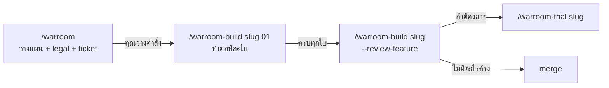
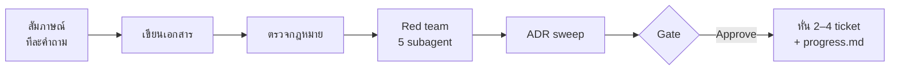
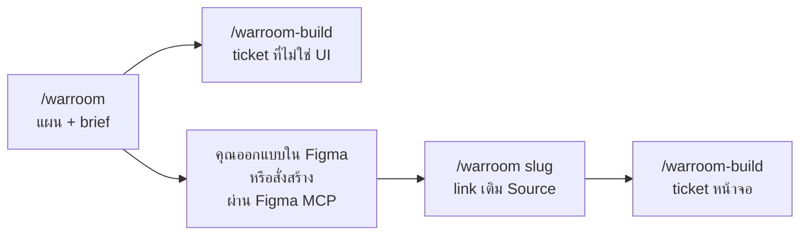
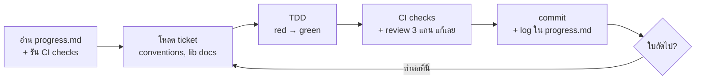
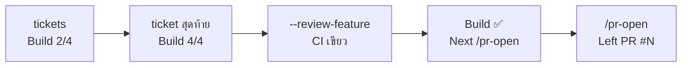
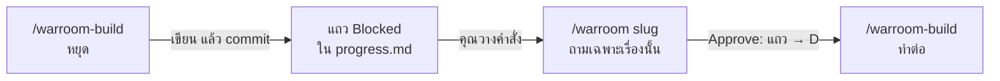
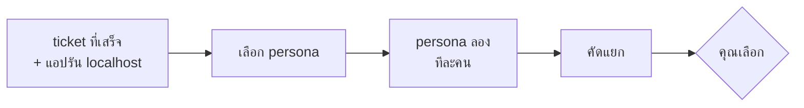

# skill ของ warroom ทำงานต่อกันยังไง

[English](flow.md) · **ไทย**

มี 3 skill: **warroom** วางแผนและหั่น ticket, **warroom-build** สร้างตาม
ticket, **warroom-trial** ให้ผู้ใช้สมมุติลองใช้ ส่วน **kiki-debug** หาสาเหตุ bug — เรียกเองด้วย
`/kiki-debug {อาการ}` หรือ build เรียกให้ระหว่างทำ ticket มีสองไฟล์ที่ตอบสองคำถามที่ถามบ่อย:

- **ตอนนี้แต่ละ feature ถึงไหนแล้ว?** `docs/progress/board.md` — feature ละแถว
  พร้อมคำสั่งถัดไป
- **เรื่องนี้เคยตัดสินไปแล้วหรือยัง?** `docs/decisions.md` — decision ทุกข้อของทุก
  feature ข้อละบรรทัด จัดตามเรื่อง warroom เปิดดูก่อนถามทุกข้อ จึงไม่ถามซ้ำ แต่ละแถวบอกว่า
  feature ไหนใช้ข้อนั้นอยู่ (**Used by**) เปลี่ยน decision แล้วแก้ตามได้ทุก feature

## 1. ภาพรวม



**ทุก skill จบด้วยคำสั่งถัดไปที่พร้อมก๊อป**
- ไม่ต้องคิดว่าจะรันอะไรต่อ ก๊อป code block ท้ายข้อความไปวาง
- build ทำต่อใบถัดไปใน session เดิมได้ โดยถามคุณก่อนทุกครั้ง
- ข้อที่คุณเลือกจาก trial รวมเป็น fix ticket ใบเดียว → กลับไป `/warroom-build`

**สิ่งที่คุณพิมพ์:**

```
/warroom                                   ← วางแผน, legal, ticket
/warroom-build company-user 01             ← แล้วรันคำสั่งที่มันให้ตอนจบ
/warroom-build company-user --review-feature
/warroom-trial company-user                ← ถ้าต้องการ
```

โหมดอื่น: `/warroom legal {รายการ}` (ตรวจกฎหมายอย่างเดียว) ·
`/warroom tickets {slug}` (หั่นใหม่) · `/kiki-debug {อาการ}`
(bug อะไรก็ได้)

## 2. warroom — วางแผน แล้วหั่น ticket



| ขั้น | ทำอะไร | คุณ |
|---|---|---|
| สัมภาษณ์ | ดู `docs/decisions.md` ก่อน — เคยตัดสินแล้ว → ใช้ของเดิม ไม่ถาม; จากนั้นถามทีละข้อ มีตัวเลือกแนะนำ; ตอบไม่ได้ → Open Question | ตอบ |
| เขียนเอกสาร | spec, decisions (D1… ลง index ใน `docs/decisions.md` ทันทีที่ได้), flow; หน้าจอได้ design brief (Must show) | — |
| กฎหมาย | ทีละเรื่อง → `legal.md`; `UNVERIFIED` บล็อก gate | ตอบถ้ากำกวม |
| Red team | Advocate, Builder, Breaker, Tester, Skeptic | ตัดสินเรื่องที่ต้องตัดสิน |
| ADR sweep | หา decision ระดับโปรเจค ร่าง ADR | — |
| Gate | สรุป + Open Questions | **Approve** / **Adjust** / **Stop as draft** |
| Ticket | ตั้ง conventions ถ้ายังไม่มี; 2–4 ticket ใบใหญ่แนวตั้ง; `progress.md`; แถวใน board | อนุมัติ, รวม หรือแยก |

กด **Approve** ได้เมื่อไม่มี Open Question ที่บล็อกการ build ก่อนหน้านั้น spec
เป็น `draft` และ build จะไม่รับ

**มีหน้าจอ?** สัมภาษณ์ถามครั้งเดียวว่า design มาจากไหน: Figma link, รูป, component ที่มีอยู่
หรือ **ออกแบบหลังวางแผน** ถ้าออกแบบหลังวางแผน Source ของหน้าจอเป็น `pending` และคอลัมน์
Must show คือ brief ที่เอาไปออกแบบ:



วาง link (หรือ frame ที่ Figma MCP สร้าง) แล้วแค่เติม Source, ช่อง UI ใน board เป็น `🎨`
และปลด ticket หน้าจอ ถ้า design มีของที่แผนไม่มี (field ใหม่,
ขั้นตอนใหม่) เฉพาะส่วนนั้นเป็น change request

**feature เดียว หรือแยก?** ค่าเริ่มต้นคือต่อยอด feature เดิม (change request:
`/warroom {slug}` ได้ ticket ใหม่ต่อจากใบที่ done) แยก feature ใหม่เฉพาะเมื่อมีผู้ใช้
หรือข้อมูลของตัวเองและ ship แยกได้ หรือเมื่อของเดิมกลายเป็นของอื่นไปแล้ว

**แผนใหญ่?** ประมาณ 5 เรื่องขึ้นไปที่ยังไม่ตัดสิน → session แรกทำ
`docs/progress/{slug}/map.md` แล้วหยุด session ต่อๆ ไปรัน `/warroom {slug}` ตอบทีละคำถาม แล้วค่อยทำขั้นข้างบนตามปกติ

## 3. warroom-build — ทำทีละใบต่อเนื่อง



- **เริ่ม** ด้วยการอ่าน `progress.md` — ใบก่อนทำอะไรไป ฝากอะไรไว้ — และรัน CI check ทั้งหมด จะได้รู้ว่าอะไรพังอยู่ก่อนแล้ว
- **ตรวจ** ด้วยคำสั่งเดียวกับ CI; ไม่ commit ถ้ายังมี check ที่ใบนี้ทำพัง
- **Review** เจออะไรแก้ในใบนั้นเลย ไม่เก็บไว้ทีหลัง
- **จบแต่ละใบ** เขียนสรุปใน `progress.md` (โชว์ในแชทด้วย) แล้วถาม: ทำต่อที่นี่ หรือหยุดพร้อมคำสั่งถัดไป
- ทำใบใหญ่ไป 2 ใบแล้ว จะแนะนำให้เปิด session ใหม่

### 3.1 เจอเรื่องที่เอกสารไม่ได้ตัดสิน

| กรณี | build ทำ |
|---|---|
| เอกสารตอบไว้แล้ว | ใช้คำตอบนั้น |
| เรื่องเล็กใน feature (ค่า default, ข้อความ, limit) | ตัดสินเอง บันทึกเป็น D แล้วใส่ใน log |
| เรื่องที่ผู้ใช้เห็น, กฎหมาย หรือ ADR | ถามคุณ; ยังอยู่ในกรอบ spec → เป็น D แล้วทำต่อ |
| เปลี่ยนสิ่งที่ spec สัญญาไว้ หรือคุณอยากคิดก่อน | แถว Blocked → หยุดพร้อม `/warroom {slug}` |
| error ที่อธิบายไม่ได้ | เรียก skill **kiki-debug** ใน ticket นั้นเลย แล้วทำต่อ |

## 4. board และ `progress.md` — ทุกอย่างถึงไหนแล้ว

`docs/progress/board.md` feature ละแถว:

```
| Feature        | Manual | Stage    | UI     | Build      | Left          | Next                               |
| user-contact   | false  | done     | 🎨 2/2 | ✅ 4f1c2ab | —             | —                                  |
| company-user   | true   | review   | 🎨 3/3 | ✅ 1c92373 | เปิด PR       | /pr-open                           |
| domain-monitor | false  | building | ⏳ 1/3 | 2/4        | tickets 03–04 | /warroom-build domain-monitor 03   |
| loyalty-points | false  | mapping  | —      | —          | 4 คำถาม       | /warroom loyalty-points            |
```

มี flag สองช่องข้าง Stage:

- **UI** — หน้าจอมี design แล้วหรือยัง `—` ไม่มีหน้าจอ, `⏳ 1/3` บางหน้ายัง `pending`,
  `🎨 3/3` ทุกหน้ามี design แล้ว เปลี่ยนเมื่อ link design ลงใน spec › Design › Source
  ไม่ว่าคุณวางเอง หรือสร้างผ่าน Figma MCP
- **Build** — build เสร็จและเขียวหรือยัง `2/4` ticket ที่ done, `✅ {sha}` ticket ครบ +
  feature review ผ่าน + CI เขียวที่ commit นั้น, `❌ {sha}` มี check แดง ต้อง `✅` เท่านั้น
  Next ถึงเป็น `/pr-open` ถ้ายังไม่ `✅` `/pr-open` จะถามก่อนเปิด PR และเปิดแล้ว Left
  เป็น `PR #N`



**Manual** (`true` / `false`) คุณเป็นคนตั้งเท่านั้น `true` = agent ไม่แตะแถวนั้นใน board เลย
คุณอัปเดตแถวเอง งานของ feature (ticket, `progress.md`, คำสั่งถัดไปในแชท) ยังทำตามปกติ

ทุก skill อัปเดตแถวของ feature ตัวเองตอนจบ session รายละเอียดต่อ feature อยู่ที่
`docs/progress/{slug}/progress.md`:

```
**Now:** 02 เสร็จ; ต่อไป 03
**Next:**  /warroom-build company-user 03

## Tickets      01 done · 02 done · 03 ready
## Log          ต่อใบที่เสร็จ: Built · Decided · For the next ticket · Checks
## Blocked      เฉพาะเรื่องที่ build ตัดสินเองไม่ได้
```

build ทุก session อ่านไฟล์นี้ก่อน และเขียนเป็นอย่างสุดท้าย **For the next
ticket** คือช่องที่ใบหนึ่งบอกใบถัดไปว่าต้องรู้อะไร

## 5. กลับไปแก้ — แถว Blocked



| แถวต้องการ | คุณรัน | ปิดเป็น |
|---|---|---|
| `/warroom {slug}` | คำสั่งที่ build ให้ตอนหยุด | `→ D{n}` |
| `/warroom tickets {slug}` | เหมือนกัน | `→ ticket NN` |
| `/kiki-debug {อาการ}` | เหมือนกัน เมื่อได้ log หรือข้อมูลแล้ว | `done ({sha})` |
| `/warroom {slug}` สำหรับ `design: {หน้าจอ}` | พร้อม design link | `done` |

คุณไม่ต้องแก้ `progress.md` เอง ถ้าจะทิ้งแถวไหน บอก skill

## 6. warroom-trial — ผู้ใช้สมมุติลองแอป



persona เป็น subagent ที่ **ไม่เห็นโค้ด ไม่เห็น spec**

| ประเภท | เลือกแล้ว → |
|---|---|
| **bug** / **friction** | รวมเป็น fix ticket ใบเดียว → `/warroom-build {slug} {NN}` |
| **spec gap** | แถว Blocked → `/warroom {slug}` |
| **works as intended** | จดไว้ อ้าง D |

## โฟลเดอร์ที่ได้

```
docs/
├── README.md                    ← แต่ละโฟลเดอร์มีไว้ทำอะไร
├── decisions.md                 ← decision ทุกข้อ จัดตามเรื่อง — ดูก่อนตัดสินอะไร
├── features/{slug}/             ← feature นี้คืออะไร
│   └── spec.md  decisions.md  flow.md  legal.md
├── progress/                    ← งานที่กำลังทำ
│   ├── board.md                 ← ทุก feature: ขั้นไหน flag UI กับ Build เหลืออะไร คำสั่งถัดไป
│   └── {slug}/
│       ├── progress.md  (map.md)
│       ├── tickets/             ← 2–4 ticket ใบละไฟล์
│       ├── user-trials/         ← รายงาน trial
│       └── bugs/                ← การไล่ bug ของ feature นี้
├── adr/                         ← กฎที่ทุก feature ต้องทำตาม
├── library-notes/               ← docs library แนะนำอะไร สำหรับเวอร์ชันที่ติดตั้ง
├── bugs/                        ← bug นอก feature
└── legal/                       ← ตรวจกฎหมายแบบเดี่ยว
.claude/skills/{framework}-{surface}/   ← กติกาการเขียนโค้ดของโปรเจค
```

โปรเจคเก่า (progress กับ ticket อยู่ใน `features/{slug}/`) จะถูกย้าย
เข้าโครงนี้ครั้งเดียว ตอนที่ skill warroom ตัวไหนก็ได้รันครั้งแรก ส่วน `docs/adr/`
คงไว้ตามเดิม

## ศัพท์

| คำ | ความหมาย |
|---|---|
| **D{n}** | decision หนึ่งข้อใน `decisions.md` ของ feature; อ้างจากที่อื่นใส่ slug ด้วย: `user-contact D4` |
| **ADR** | กฎระดับโปรเจคที่ feature ต่อไปต้องทำตาม (`docs/adr/`) |
| **Used by** | feature ที่ใช้ decision นั้นซ้ำ; เปลี่ยน decision แล้วแก้ตามได้ทุกตัว |
| **seam** | จุดที่ test สังเกตพฤติกรรม ตกลงไว้ใน spec |
| **(e2e)** | พฤติกรรมที่เห็นได้บนจอเท่านั้น ตรวจด้วย e2e tool ของโปรเจค |
| **Blocked** | แถวใน `progress.md` ที่ build ตัดสินเองไม่ได้ |
| **conventions** | กติกาเขียนโค้ดของโปรเจค `.claude/skills/{framework}-{surface}/` |
| **persona** | ผู้ใช้สมมุติใน trial |
